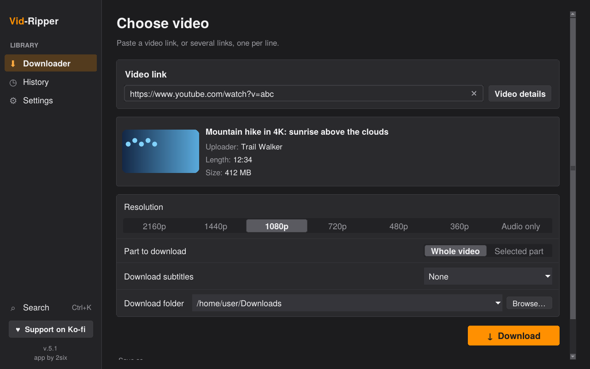
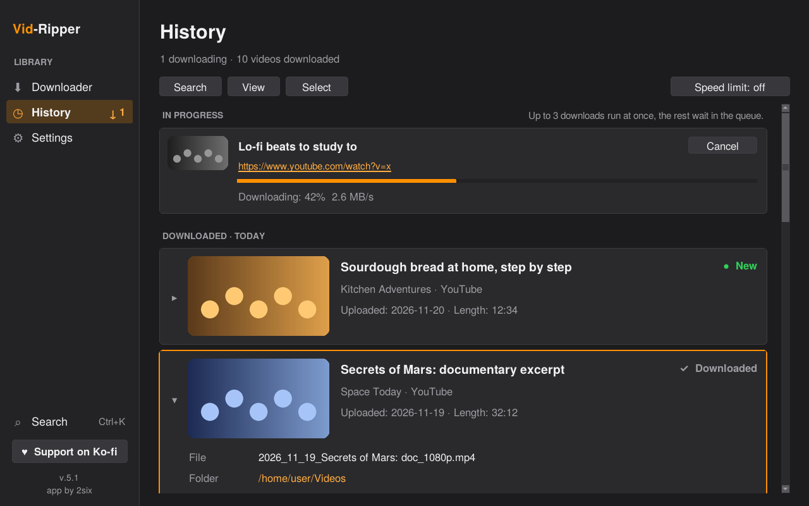
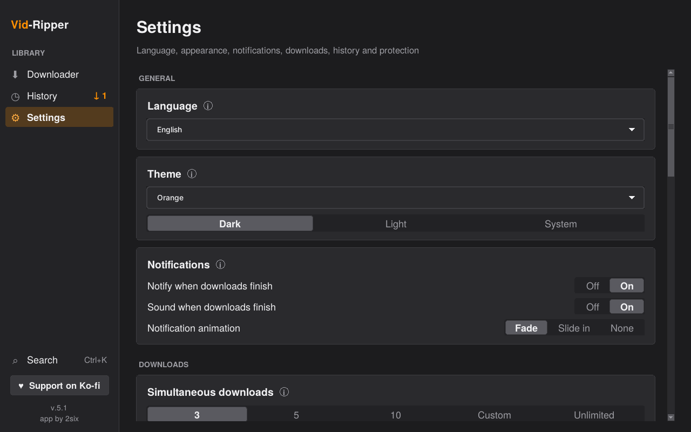

# Vid-Ripper

A simple video and music downloader for Mac, Windows and Linux. Paste a link, pick the
quality, and the app does the rest. Built on [yt-dlp](https://github.com/yt-dlp/yt-dlp)
and [FFmpeg](https://ffmpeg.org), with a native-feeling interface in English, Hungarian
and German.

[Magyar leírás lent](#magyarul)



## Features

- Downloads from YouTube and hundreds of other sites, up to 4K and HDR
- Save music as mp3 in the quality you choose
- Playlists and whole channels, picking only the videos you want
- Record live streams, even from the beginning (YouTube)
- Download just a selected part of a video
- Subtitles as a separate .srt file
- Cut sponsored segments from YouTube videos ([SponsorBlock](https://sponsor.ajay.app)), optionally with a short fade
- Cover image, title and chapters embedded in the files
- Several downloads at once with a queue, and an optional speed limit
- Built-in player (mpv, or FFmpeg as a fallback)
- Searchable history that can be locked with a password
- Warning when a link was already downloaded
- Four colour themes, dark and light mode
- Built-in yt-dlp updater, so sites keep working without a new app version

| History | Settings |
|---|---|
|  |  |

## Download

Get the latest version from the [Releases page](../../releases/latest).

**Mac** (Apple Silicon)
1. Download `Vid-Ripper-…-Mac.zip` and `install_mac.sh` into your Downloads folder.
2. Open Terminal and run `bash ~/Downloads/install_mac.sh`. It copies the app to
   Applications and removes the quarantine flag, so macOS lets the unsigned app start.
3. Install FFmpeg and mpv with [Homebrew](https://brew.sh): `brew install ffmpeg mpv`.

**Windows** (64-bit)
1. Download `Vid-Ripper-…-Windows.zip` and extract it anywhere, even to a USB drive.
2. Start `Vid-Ripper.exe`. FFmpeg and mpv are included.
3. The app is not signed, so SmartScreen may warn you the first time: click
   *More info*, then *Run anyway*.

Settings and history are kept in a hidden `adatok` folder next to the exe, so the whole
folder can be moved together.

**Linux** (x86_64)
1. Download `Vid-Ripper-…-Linux.tar.gz` and extract it.
2. Start the `.AppImage` file. FFmpeg and mpv are included.

## Run from source

Python 3.10 or newer with Tkinter is needed, plus FFmpeg and mpv on the system.

```
pip install "yt-dlp[curl-cffi]" pillow sounddevice tkinterdnd2
python PHDL.py
```

`build_desktop.py` builds the same packages as the Releases page with PyInstaller
(`pip install pyinstaller` first).

## Notes

- Please respect the terms of the sites you download from and the rights of the
  creators. Download only what you are allowed to.
- Settings, history and the log file (`phdl.log`) are stored on your own computer only.
  The app connects to the sites you download from, to PyPI (yt-dlp updates) and, for
  YouTube videos, to SponsorBlock (only a short hash of the video ID is sent).
- If something goes wrong, please open an issue and attach `phdl.log`. On Mac it is in
  `~/Library/Application Support/Vid-Ripper`, on Windows in the `adatok` folder, on Linux
  in `~/.config/vid-ripper`.

## License

Vid-Ripper is released under the [MIT License](LICENSE). The packages also contain
third-party software (FFmpeg, mpv, yt-dlp and others) under their own licenses; see
[THIRD_PARTY_LICENSES.md](THIRD_PARTY_LICENSES.md).

If you like the app, you can support it on [Ko-fi](https://ko-fi.com/twosix989).

---

## Magyarul

Egyszerű videó- és zeneletöltő Macre, Windowsra és Linuxra. Bemásolod a linket,
kiválasztod a minőséget, a többit az app intézi. A háttérben a
[yt-dlp](https://github.com/yt-dlp/yt-dlp) és az [FFmpeg](https://ffmpeg.org) dolgozik,
a felület magyarul, angolul és németül is elérhető.

### Mit tud?

- Letöltés YouTube-ról és több száz más oldalról, akár 4K-ban és HDR-ben
- Zene mentése mp3-ba, választható minőségben
- Lejátszási listák és teljes csatornák, csak a kiválasztott videókkal
- Élő adások felvétele, YouTube-on akár az adás elejétől
- Egy videónak csak a kijelölt része is letölthető
- Feliratok külön .srt fájlban
- Szponzorált részek kivágása YouTube videókból ([SponsorBlock](https://sponsor.ajay.app)), akár rövid áttűnéssel
- Borítókép, cím és fejezetek a letöltött fájlokban
- Egyszerre több letöltés várakozási sorral, igény szerint sebességkorláttal
- Beépített lejátszó (mpv, vagy tartalékként FFmpeg)
- Kereshető előzmények, jelszavas védelemmel
- Figyelmeztetés a már letöltött linkekre
- Négy színtéma, sötét és világos módban
- Beépített yt-dlp frissítés, így az oldalak új app nélkül is működnek tovább

### Letöltés és telepítés

A legfrissebb változat a [Releases oldalon](../../releases/latest) van.

**Mac** (Apple Silicon)
1. Töltsd le a `Vid-Ripper-…-Mac.zip` és az `install_mac.sh` fájlt a Letöltések mappába.
2. A Terminálban futtasd: `bash ~/Downloads/install_mac.sh`. Ez bemásolja az appot az
   Alkalmazások közé, és leveszi róla a karantén jelölést, így a macOS elindítja az
   aláírás nélküli appot.
3. Az FFmpeg és az mpv a [Homebrew](https://brew.sh)-val telepíthető:
   `brew install ffmpeg mpv`.

**Windows** (64 bites)
1. Töltsd le a `Vid-Ripper-…-Windows.zip` fájlt, és csomagold ki bárhová, akár
   pendrive-ra is.
2. Indítsd a `Vid-Ripper.exe`-t. Az FFmpeg és az mpv benne van.
3. Az app nincs aláírva, ezért első indításkor a SmartScreen figyelmeztethet: kattints a
   *További információ*, majd a *Futtatás mindenképpen* gombra.

A beállítások és az előzmények az exe melletti rejtett `adatok` mappában vannak, így az
egész mappa egyben áthelyezhető.

**Linux** (x86_64)
1. Töltsd le a `Vid-Ripper-…-Linux.tar.gz` fájlt, és csomagold ki.
2. Indítsd az `.AppImage` fájlt. Az FFmpeg és az mpv benne van.

### Futtatás forrásból

Python 3.10 vagy újabb kell Tkinterrel, a gépen pedig FFmpeg és mpv.

```
pip install "yt-dlp[curl-cffi]" pillow sounddevice tkinterdnd2
python PHDL.py
```

### Fontos

- Tartsd tiszteletben az oldalak felhasználási feltételeit és az alkotók jogait. Csak
  azt töltsd le, amihez jogod van.
- A beállítások, az előzmények és a napló (`phdl.log`) csak a saját gépeden vannak. Az
  app csak a letöltési oldalakhoz, a PyPI-hoz (yt-dlp frissítés) és YouTube videóknál a
  SponsorBlockhoz kapcsolódik (ilyenkor csak a videó azonosítójának egy rövid hash-e megy el).
- Ha valami nem működik, nyiss egy issue-t, és csatold a `phdl.log` fájlt. Macen a
  `~/Library/Application Support/Vid-Ripper`, Windowson az `adatok`, Linuxon a
  `~/.config/vid-ripper` mappában van.

### Licenc

A Vid-Ripper [MIT licenc](LICENSE) alatt érhető el. A kész csomagokban más programok is
vannak (FFmpeg, mpv, yt-dlp és mások) a saját licencükkel, ezek listája a
[THIRD_PARTY_LICENSES.md](THIRD_PARTY_LICENSES.md) fájlban van.

Ha tetszik az app, a [Ko-fi](https://ko-fi.com/twosix989) oldalon támogathatod.
